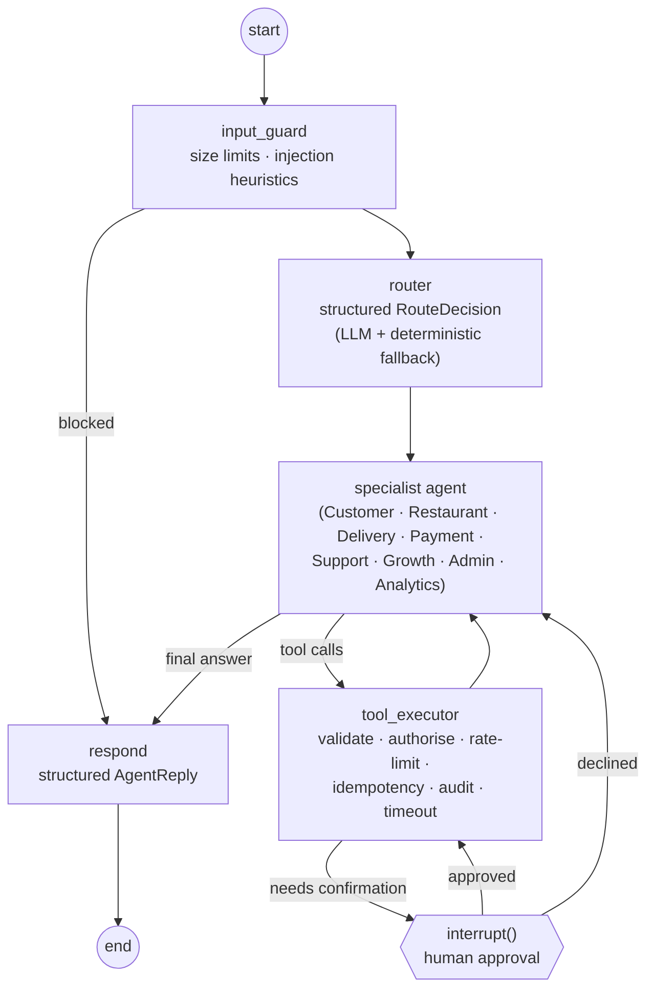

# AI Multi-Agent System (`services/agents`)

The AI service is a separately deployed LangGraph application (Cloud Run). It never touches a
database that holds business data: every action is a **typed tool** that calls `gudmeal-api` with the
end user's Firebase ID token, so the API re-applies authentication, RBAC, ownership checks, pricing and
the order state machine. The model can plan; only the backend can act.

## Graph

- **State**: `messages`, `principal` (uid, roles, restaurant ids — injected by the server, never by the model),
  `active_agent`, `route_reason`, `pending_approval`, `tool_results`, `usage`.
- **Router**: Gemini with structured output (`RouteDecision`), validated by Pydantic. Falls back to a
  deterministic role + keyword router if the model errors or returns an agent the user may not use.
- **Specialist agents**: each has a system prompt and an allow-list of tools; the tool list is further
  filtered by the principal's roles before it is bound to the model.
- **Tool executor**: a custom node (not the prebuilt `ToolNode`) so every call goes through the registry
  pipeline: Pydantic argument validation → role permission → per-user rate limit → approval gate →
  timeout → API call with idempotency key → audit log → result validation.
- **Approval**: tools flagged `requires_approval` (e.g. `confirm_order`, `request_refund_review`,
  admin actions) pause the graph with `interrupt()` and a server-computed summary (e.g. exact quote total).
  The client resumes with `Command(resume={"approved": bool})`.

## Persistence & memory

| Memory | Mechanism | Isolation |
|---|---|---|
| Short-term (thread) | LangGraph checkpointer — `AsyncPostgresSaver` in cloud, SQLite/in-memory locally | `thread_id` is server-generated and bound to the owner's uid in `agent_threads`; every request checks ownership |
| Long-term (preferences) | `customer_profiles` via API tools (`get_my_preferences`, `update_my_preferences`) | API enforces owner-only access |
| Summaries | `agent_conversations/{thread}` (title, short summary) | owner-only rules; no payment data is ever stored |

## Model strategy

- Provider: Google Gemini via `langchain-google-genai`; model id from `GEMINI_MODEL`
  (fallback model from `GEMINI_FALLBACK_MODEL`). Production pins a stable model id verified with
  `scripts/check_gemini_models.py`.
- Usage & cost: token usage from each response's `usage_metadata`, priced with env-configured rates,
  stored per run in `agent_usage` and exposed to the Command Centre.
- Observability: LangSmith tracing when `LANGSMITH_TRACING=true`; structured logs otherwise.
- Deterministic fallbacks: the budget meal planner, quotes, totals, ETAs and dispatch scoring are
  backend algorithms. If Gemini is unavailable the router falls back to rules and the assistant returns
  a safe message plus deep links into the normal ordering UI.

## Agents and their tools (summary)

| Agent | Who can use it | Example tools |
|---|---|---|
| Customer | customers | `search_restaurants`, `search_food_items`, `get_restaurant_menu`, `plan_meal_within_budget`, `create_order_draft`, `confirm_order` (approval), `get_order_status`, `reorder` |
| Restaurant | restaurant roles | `list_restaurant_orders`, `accept_order` (approval), `set_item_availability`, `get_restaurant_analytics` |
| Delivery | operations, riders | `get_delivery_tracking`, `get_available_riders` (ops), `request_rider_assignment` (ops, approval) |
| Payment | customers (own), finance | `get_payment_status`, `verify_payment`, `request_refund_review` (approval) |
| Support | everyone | `get_order_status`, `create_support_ticket`, `report_order_issue`, `search_help_articles` |
| Growth | customers, marketing | `get_my_vouchers`, `suggest_promotions` (marketing) |
| Admin | operations, super admin | `get_admin_overview`, `list_exceptions` |
| Analytics | restaurant managers, admins | `get_restaurant_analytics`, `get_admin_analytics` |

## Safety rules enforced in code

- The model never sees or produces authoritative amounts: totals are read from API responses.
- Tools cannot take `user_id`, `customer_id` or `role` arguments; identity comes from the verified token.
- Prompt-injection heuristics on input and on tool results (tool output is wrapped as data).
- Approval cannot be bypassed: `confirm_order` without a matching approved interrupt is rejected.
- Payment card details are never requested, stored or logged; checkout happens on the provider page.

## Yummy: persona, languages and offline mode (2026-11-15)

- **Persona.** Yummy is Yummy Chops' assistant for Order Food, Pharmacy, Beauty & Skin Care, Shop & Groceries, Buy
  Foodstuff and Package Delivery in Lagos and Enugu. It is not a pharmacist or a doctor: no diagnosis, no medicine or
  dose for a symptom, no health claims; for a symptom it opens the matching Pharmacy aisle and lets the customer choose.
  It replies in the customer's language (English, Nigerian Pidgin, Igbo, Yoruba, Hausa), mirroring code-mixing,
  and keeps dish, product and store names exactly as tools return them.
- **New tools** (`tools/services.py`): `list_services`, `get_order_totals` (exact totals from
  `/v1/me/order-summary`), `open_screen` (a button that directs the customer to Food, Beauty, Package Delivery,
  Orders, Support, Profile, a store or an order), `get_support_contacts`, `get_parcel_quote` (free-text addresses
  placed with `/v1/places/resolve`; sender defaults to the signed-in account) and `book_parcel` (approval
  required; creates the order and a payment link). Search tools take `service = food | beauty`.
- **Offline mode** (`offline.py`). Without `GOOGLE_API_KEY` the service uses a deterministic rule-based model
  implementing the same `ModelFactory` protocol, so it runs inside the normal graph and every action still goes
  through validation, permissions, rate limits, audit and approval screens. It detects the language (keyword
  markers), routes by keywords, and handles greetings, services, totals, food and beauty search, tracking,
  support, package delivery (sends the customer to the booking screen) and the budget meal flow
  (plan → draft → approval → payment link), including follow-ups such as “plan 2”, “yes” or “no”. Replies are
  templated: full English and Pidgin; Igbo, Yoruba and Hausa get a localised greeting/acknowledgement and English
  details. All numbers are copied from tool results. `/health` reports `ai_mode: offline | llm`.
- **Money (phase 2).** `get_wallet` (balance, recent activity, seller COD balance; read-only) and
  `get_payment_options` (card / wallet / pay on delivery with the server's reasons). Yummy can open the Wallet
  screen but has no tool that tops up, moves or withdraws money. Offline mode answers wallet, pay-on-delivery
  and seller cash-on-delivery questions in English and Pidgin.
- **Interstate waybill (phase 3).** Two read-only tools for the customer, delivery and support agents:
  - `get_waybill_options`: destinations from the customer's city, with from-prices, transit days, and door
    delivery or collection points.
  - `track_waybill`: by tracking number, or the customer's latest waybill; it uses the public tracking
    endpoint, so no personal data is involved.

  Booking happens on the app or website screen that Yummy opens (`open_screen` → `waybill`), so no new
  approval-gated tool was needed. Offline mode recognises tracking numbers, “send to Abuja”-style
  questions and “where is my waybill”. Yummy now has 40 tools; as before, every price it states is copied
  from a tool result.
- **Plus, points and group orders (phase 4).** Three read-only tools for the customer, support and growth
  agents:
  - `get_plus_membership`: price, benefits, membership and savings
  - `get_rewards`: points, redeem steps, personal vouchers, referral code
  - `get_group_orders`: my groups, status, join code, my share

  `open_screen` gains `plus`, `rewards` and `group`. Yummy never joins Plus, redeems points, applies codes
  or pays shares; the customer does that on the screen Yummy opens. Offline mode answers these questions in
  English and Pidgin. Yummy now has 43 tools.
- **WhatsApp (phase 5, [ADR-0017](../adr/0017-assistant-on-whatsapp.md)).** The API runs Yummy for linked WhatsApp
  numbers through the normal `POST /v1/chat`, with `channel: "whatsapp"` and a short-lived channel token that
  carries only the `customer` role. There are no new tools.
  - **Style.** The `whatsapp` channel adds a prompt hint: short plain-text replies, and approvals answered with
    the Yes/No buttons.
  - **Approvals.** The API turns them into WhatsApp reply buttons. The text comes from the tool's server-side
    preview, which now spells out where the order goes ("Delivering to Lekki Phase 1, Lagos") because WhatsApp has
    no order screen. The street address stays out of the order summaries the model reads.
  - **Shared locations.** A location shared in the chat reaches Yummy as `delivery_address`, so plans, quotes
    and drafts use it instead of the first saved address.
  - **Order channel.** Orders and support tickets Yummy creates in a WhatsApp chat are saved with channel
    `whatsapp`; from the app and website they stay `ai_agent`.
  - **Routing.** Food and budget requests ("I have ₦10,000, find me food for 2") go back to the customer agent
    even mid-way through a growth conversation.
  - **Service identity.** Yummy's tool calls to the API carry a service credential (`INTERNAL_AUTH_MODE`: a
    Google-signed OIDC token in the cloud, the shared secret locally) so they pass App Check. The customer's
    own token is still required on every call.
